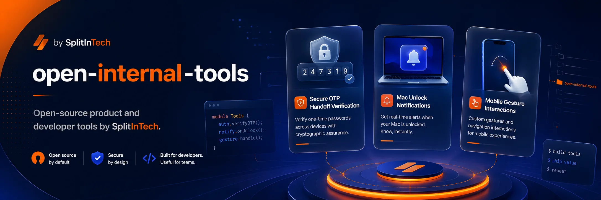

<p align="center">
  
</p>

# Open Internal Tools

The catalog for SplitIn's independently maintained open-source tools. **All 14 products
have moved to their own repositories.** Product source, tests, issues and releases belong
in those repositories; this hub maintains the directory, program guidance and migration records.

<p align="center">
  
</p>

## Projects

Choose a repository below for installation instructions, API documentation, examples,
configuration and current release status. Distribution describes the project's format;
it does not mean a package is already published or a hosted integration is production-ready.

| Product / repository | Distribution | Runtime | What it does | Documentation |
| --- | --- | --- | --- | --- |
| [AirDrop QR](https://github.com/splitintech/airdrop-qr) | npm library and CLI | Node.js 20+ | Generate offline HTML QR cards for AirDrop sharing. | [README](https://github.com/splitintech/airdrop-qr#readme) |
| [In-app OTP](https://github.com/splitintech/in-app-otp) | npm library | TypeScript / Node.js | Framework-neutral OTP handoff and verification adapters. | [README](https://github.com/splitintech/in-app-otp#readme) |
| [Contact Converter](https://github.com/splitintech/rtf-to-vcard) | Python CLI | Python 3.9+ | Convert TXT, CSV, HTML and RTF contacts into vCard exports. | [README](https://github.com/splitintech/rtf-to-vcard#readme) |
| [Mac Unlock Notify](https://github.com/splitintech/mac-unlock-notify) | macOS utility | zsh / macOS | Send a Slack notification when a Mac is unlocked. | [README](https://github.com/splitintech/mac-unlock-notify#readme) |
| [Verification Adapter SDK](https://github.com/splitintech/verification-adapter-sdk) | npm workspace | Node.js 20+ | Provider contracts, verification engine, server, CLI and adapters. | [README](https://github.com/splitintech/verification-adapter-sdk#readme) |
| [Dev Tools Client](https://github.com/splitintech/dev-tools-client) | npm browser facade | TypeScript / React | Browser-facing verification tools with bundled dependencies. | [README](https://github.com/splitintech/dev-tools-client#readme) |
| [Slack Agent HQ](https://github.com/splitintech/slack-agent-hq) | Node.js application | Node.js 22.13+ | Route project threads and agent requests through Slack. | [README](https://github.com/splitintech/slack-agent-hq#readme) |
| [Ideation Loop System](https://github.com/splitintech/ideation-loop-system) | Node.js application | Node.js 22.13+ | Coordinate planning, implementation and review in Slack threads. | [README](https://github.com/splitintech/ideation-loop-system#readme) |
| [Agent Router](https://github.com/splitintech/vscode-agent-router) | VS Code / Cursor extension | Node.js 20+ | Dispatch work through MCP, CLI and API integrations. | [README](https://github.com/splitintech/vscode-agent-router#readme) |
| [Group Share](https://github.com/splitintech/group-share) | npm library and gateway | Node.js 20+ | Restrict shared app links by invite list, network and expiry. | [README](https://github.com/splitintech/group-share#readme) |
| [JPMC Zelle Quick Pay](https://github.com/splitintech/jpmc-zelle-quick-pay) | npm library / synthetic beta | Node.js 22+ / React | Orchestrate payment journeys; not a production banking integration. | [README](https://github.com/splitintech/jpmc-zelle-quick-pay#readme) |
| [Neighborhood Map Studio](https://github.com/splitintech/neighborhood-map-studio) | Application / container | Python 3.11 / Node.js 22+ | Edit illustrated OSM neighborhood maps with Leaflet and FastAPI. | [README](https://github.com/splitintech/neighborhood-map-studio#readme) |
| [Outreach Engine](https://github.com/splitintech/outreach-engine) | 12 npm packages and clients | Node.js 22.13+ | Durable outreach orchestration with CLI, HTTP, MCP and Papr clients. | [README](https://github.com/splitintech/outreach-engine#readme) |
| [Moggridge](https://github.com/splitintech/moggridge) | npm React library | React / React Native | Cross-platform motion, gestures and interaction primitives. | [README](https://github.com/splitintech/moggridge#readme) |

## Getting started

Clone the selected product repository and follow its README. For example:

```sh
git clone https://github.com/splitintech/airdrop-qr.git
cd airdrop-qr
npm ci
npm test
npm run build
```

Some projects are npm libraries; others are applications, a Python CLI, a macOS utility,
or an editor extension. Each repository documents its own requirements and operational
limits. In particular, Map Studio includes a Python service, and Zelle remains a synthetic-development beta.

## Migration and history

The former product directories have been removed from `main`. Their source history,
tags and releases remain in Git. Old folder URLs targeting `main` no longer resolve;
use the canonical repositories above or the immutable links in the
[migration index](docs/migrations/README.md).

- [First nine migrations](docs/migrations/2026-10-29.json)
- [Four previously branch-only products](docs/migrations/2026-10-29-remaining.json)
- [Moggridge provenance](https://github.com/splitintech/moggridge/blob/main/docs/migration.md)

Migration ledgers describe the source and destination snapshots at the time of each move.
Historical branches remain available for reference. New work and releases belong in the
standalone repositories. This hub has no product build or publishing workflow.

## Branch protection

The product repositories protect their default branch with pull requests, required CI
checks, and blocks on force pushes and branch deletion. See the
[protection policy and verified repository rules](docs/repository-protection.md) for
check names and links. A repository administrator can manage these rules in GitHub settings.

## Contributing

For a product change or bug report, use its canonical repository. For directory, program
or migration-documentation changes, open a pull request here and run:

```sh
python3 scripts/check-catalog.py
```

See [CONTRIBUTING.md](CONTRIBUTING.md). The [program guide](docs/program.md) preserves
our engineering mission, contributor model and open-source product philosophy.

## SplitIn

- [Engineering and the wider tech stack](https://www.splitin.net/tech-stack)
- [Open Internal Tools on SplitIn](https://www.splitin.net/tech-stack/open-internal-tools)
- [Careers and project maintainers](https://www.splitin.net/careers-requests)

## License

This catalog is MIT-licensed; see [LICENSE](LICENSE). Consult each product repository
for its license and dependency notices.
